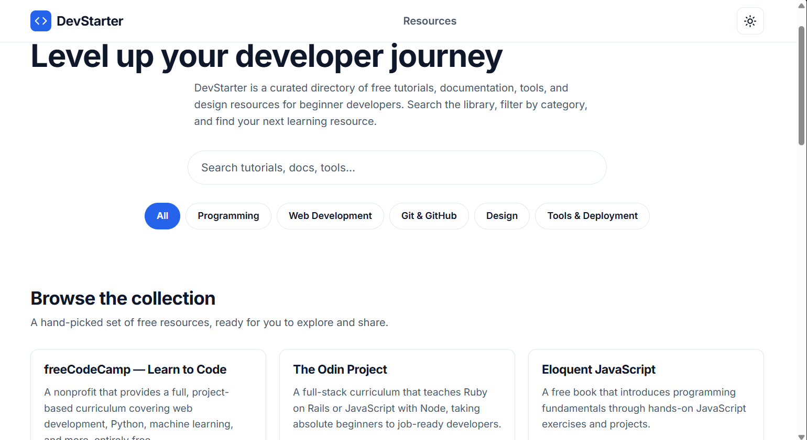

# DevStarter

**DevStarter** is an open-source, beginner-friendly directory of free resources for people
learning to code.

It currently helps developers:

- Discover programming tutorials and documentation.
- Find HTML, CSS, and JavaScript learning resources.
- Learn Git and GitHub workflows.
- Find design, tooling, API, and deployment resources.

The project is intentionally built with **vanilla HTML, CSS, and JavaScript** so that
beginners can read, understand, and contribute to the codebase without learning a framework.

## Features

- Search resources by title and description.
- Filter resources by category.
- Responsive card grid of curated resources.
- Empty state with a reset action.
- Light / dark theme toggle, persisted in `localStorage`.
- Accessible markup and keyboard-friendly controls.

## Screenshot



## Technologies used

- HTML5
- CSS3 (custom properties for theming, no frameworks)
- Vanilla JavaScript (ES modules, browser APIs only)

No frameworks, no CSS frameworks, no npm packages, no backend, and no build step.

## Local setup

1. Clone the repository:

   ```bash
   git clone https://github.com/your-username/<repo-name>.git
   cd <repo-name>
   ```

2. Start a local HTTP server:

   ```bash
   # Python 3
   python3 -m http.server 8000

   # or Node.js
   npx serve .
   ```

3. Open <http://localhost:8000> in your browser.

> **Note:** Because the app uses ES modules, it must be served over HTTP (not opened directly
> via `file://`).

## Project structure

```
devstarter/
├── index.html
├── css/
│   └── style.css
├── js/
│   ├── app.js
│   ├── search.js
│   ├── filters.js
│   ├── theme.js
│   └── data/
│       └── resources/
│           ├── programming.js
│           ├── web-development.js
│           ├── git-github.js
│           ├── design.js
│           └── tools-deployment.js
├── assets/
├── tests/
│   └── manual-test-checklist.md
├── .github/
├── workshop/
├── README.md
├── CONTRIBUTING.md
└── LICENSE
```
## Add a web accessibility learning resource to the library

Add a beginner-friendly resource to help developers learn about web accessibility.

- **Title:** Introduction to Web Accessibility
- **Description:** Learn the fundamentals of web accessibility, including keyboard navigation, screen readers, alternative text, and inclusive web design.
- **Category:** Web Development
- **Resource URL:** https://www.w3.org/WAI/fundamentals/accessibility-intro/

This resource helps developers understand how to build websites that are accessible to people with disabilities.

## Contributing

Contributions are welcome! Please read [CONTRIBUTING.md](CONTRIBUTING.md) for the full
workflow, and pick an issue from the issue section on GitHub.

## How to run the manual tests

Open [`tests/manual-test-checklist.md`](tests/manual-test-checklist.md) and verify the core
flows: search, filtering, empty state, theme persistence, external links, and responsiveness.

## License

This project is licensed under the [MIT License](LICENSE).
